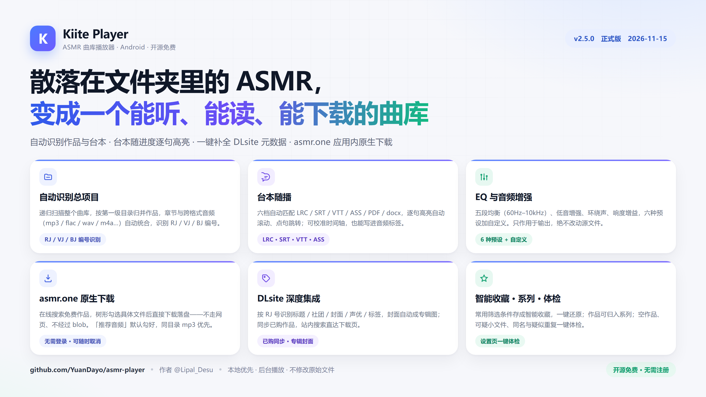

# Kiite Player（Android ASMR 播放器）

> 开源地址：<https://github.com/YuanDayo/asmr-player> ｜ 作者 **@Lipal_Desu** ｜ B 站：<https://space.bilibili.com/636898526>



**最新版本与下载**：[Releases](https://github.com/YuanDayo/asmr-player/releases)（版本号以安装包为准，不在本文件手写）

**最近一次正式版更新要点**：[更新宣传图](docs/promo/update-2.5.0.png) ｜ [完整更新日志](CHANGELOG.md)

- **下载体验**：进度条（百分比 / 速度 / 剩余时间）、后台下载 + 通知栏进度与取消、下载前容量估算、
  先写临时文件再改名（不再留半截文件）；asmr.one 与 DLsite 同一套
- **asmr.one 原生下载**：搜到即下，树形勾选具体文件，直连官方接口落盘到曲库（不走网页 / 浏览器）
- **EQ 与音频增强**：五段均衡 + 低音增强 + 环绕 + 响度增益，6 种预设，只作用于输出
- **智能收藏 / 系列 / 作品体检**：筛选条件存成收藏一键还原、作品归入系列、重复与空作品一次查清
- **DLsite 已购与站内搜索**：主页直显已购未下载，搜索可直接查站内作品
- 界面：筛选面板分区化、筛选行收窄、台本阅读器主题、沉浸播放强化

一个界面简洁的 ASMR 播放器：选一个装着 ASMR 解压文件夹的目录，它会自动把每部作品识别成
一个「总项目」，把该作品散落在各个子文件夹里的音频统合在一起；自动找出并匹配台本，
播放时随进度展示台本；需要时还能把台本写进音频标签里。匹配不理想也可手动指定台本。

除音频外也支持**视频播放**（mp4 / mkv / webm 等）与**图片查看**（融入播放页，可全屏翻看）；
接入 **DLsite**：按 RJ 编号识别作品名 / 社团 / 封面 / 标签 / 声优，封面自动作为专辑封面，
支持账号登录、已购作品同步与应用内下载；接入 **asmr.one**：在线搜索免费作品，
并可直接在应用内挑文件、原生下载到曲库（不经过网页）。界面为 iOS 风格：白底无描边卡片、克制的中性灰。

## 功能

- **自动识别总项目**：按曲库根目录下的第一级子目录归并「总项目」，识别 RJ/VJ/BJ 等作品编号
  （如 RJ123456）显示在标题里；项目内再按子文件夹切分「章节」，全部音频统合展示。
- **自动识别音频与台本**：递归扫描，支持 mp3 / flac / m4a / wav / ogg / opus / ape 等音频，
  以及 txt / md / lrc / srt / **vtt**(WebVTT) / ass / docx / pdf 台本。
- **自动匹配**（六档）：同名 → 同编号 → 父子目录 → **同一总项目的不同子文件夹**
  （音频/ 与 台本/ 并列时也能配上）→ 整项目共用 → 名称相似。
- **手动指定台本**：每首曲目旁的「选择台本」按钮，可从任意目录挑台本覆盖自动匹配，
  持久保存、可随时清除回落到自动匹配。
- **专辑封面**：优先用项目文件夹里的封面图（cover / folder / jacke t等命名或最大图片）；
  没有则读取音频内嵌封面（MP3 APIC / FLAC PICTURE / M4A covr）。曲库列表、播放页、迷你条均显示。
- **EQ 与音频增强**：五段均衡（60Hz–10kHz）+ 低音增强 + 环绕声 + 响度增益，
  六种预设 + 自定义；只作用于播放输出流，不修改源文件，关闭即完全释放。
- **智能收藏与系列**：常用筛选条件可存为命名智能收藏一键应用；作品可标注所属系列，按系列筛选。
- **asmr.one 在线下载**：搜索免费作品后可直接在应用内原生下载——树形勾选具体文件、
  默认勾选推荐音频（mp3 > wav > flac 去重）、保持站内目录结构落盘后自动重扫曲库。
- **作品体检**：空作品、可疑小文件、跨作品同名、疑似重复检测，报告入口在设置主页。
- **播放列表**：播放页可切到「播放列表」，列出当前总项目内**全部音频（跨章节、跨格式统合）**，
  显示格式与台本状态，点击即跳播，并自动跟随当前曲目。
- **台本随播**：LRC / SRT / **WebVTT** / ASS 带时间轴时逐句高亮自动滚动，点句子跳转；
  纯文本（txt / md / docx / pdf）若在行首标注了时间（`[00:12]`、`00:12：`、`1:02:03 -`）
  也会自动识别成时间轴并对齐；深色模式下纯文本使用主题前景色，不会出现黑字看不见。
- **系统通知**：播放通知/锁屏卡片点击直接回到应用。
- **文件选择**：内置文件/文件夹浏览器，并可「用其他应用打开」交给系统文件管理器（SAF）。
- **皮肤自定义**：4 套配色（深海/薄荷/樱花/纸质）× 深色三态（跟随系统/浅色/深色）
  × 5 种背景预设（默认/深海渐变/夜樱/薄荷/纸纹）+ 自定义背景图。
- **嵌入标签**（可选，默认不改原文件）：MP3 → ID3v2 `USLT`；FLAC → `LYRICS`；
  M4A/MP4 → ©lyr（moov 变长时自动修正 stco/co64 偏移）。
- **后台播放**：Media3 `MediaSessionService`。
- **HyperOS 风格 UI**：悬浮胶囊底栏（选中项带胶囊指示）、大圆角卡片（26dp）、
  圆角迷你播放条、加粗大标题；圆角尺寸由主题统一控制。

## 目录结构

```
asmr-player/
├── gradlew / gradlew.bat / gradle/wrapper/     # Gradle Wrapper（已配国内镜像）
├── gradle/libs.versions.toml                   # 版本目录
└── app/src/
    ├── main/java/com/asmrplayer/
    │   ├── core/          # 纯 Kotlin：扫描、匹配、项目分组、封面查找、解析、标签读写
    │   ├── data/          # 设置、曲库缓存、手动指定台本、内嵌封面缓存
    │   ├── playback/      # Media3 播放服务（含通知点击跳转）
    │   ├── pdf/           # pdfbox-android
    │   ├── ui/            # Compose 界面（含文件夹/台本/背景图选择器）
    │   └── util/          # 权限、SAF 路径还原
    └── test/java/com/asmrplayer/core/           # 76 个 JVM 单元测试
```

## 构建

需要 JDK 17 + Android SDK（platform 35 / build-tools 35）。

```powershell
$env:JAVA_HOME='<你的 JDK 17>'
$env:ANDROID_HOME='<你的 Android SDK>'
.\gradlew.bat assembleDebug        # app/build/outputs/apk/debug/com.kiite.player-2.2beta.apk
.\gradlew.bat testDebugUnitTest     # 核心逻辑单元测试
```

## 安装

1. 装 `com.kiite.player-2.2beta.apk`（需允许「安装未知来源应用」）。
2. 首次启动要求**「所有文件访问权限」**：台本可能是任意类型的文件，只给音频权限读不到。
3. 「曲库 → 选择文件夹」选中 ASMR 根目录，扫描后点开总项目即可播放。

> 音频与台本的原始文件在你主动点「写入标签」之前不会被修改。

## 匹配规则（按优先级）

| 优先级 | 规则 | 例子 |
|---|---|---|
| 0 | 手动指定 | 用户手动挑选的台本 |
| 1 | 同目录同名 | `01 深海.mp3` ↔ `01 深海.txt` |
| 2 | 同目录同编号 | `01 ×××.mp3` ↔ `01 台本.txt` |
| 3 | 父子目录 | `音频/01.mp3` ↔ `台本/01.txt` |
| 4 | 同一总项目 | `作品/audio/01.mp3` ↔ `作品/script/01.txt` |
| 5 | 整项目共用 | 项目里只有一份台本时归给没有强匹配的音频 |
| 6 | 名称相似 | Dice ≥ 0.70；编号不同（01 对 02）不会误配 |

## 已验证（Android 模拟器实测）

- 单元测试 **76 个全部通过**：解析（含 WebVTT）、匹配（含 sibling 修复与"不误配"用例）、项目分组、
  手动指定、封面查找，以及 MP3/FLAC/MP4 三种容器**歌词与内嵌封面的真实往返**。
- 曲库识别：4 个项目 / 9 首音频 / 8 首匹配；`RJ111111_Separate` 的
  `audio/01_track.mp3` 成功匹配到隔壁 `script/01_track.txt`（**本次修复的 bug**）。
- 播放列表：同一作品的 MP3 / WAV / FLAC 三种格式被统合进一个列表并标记「有台本 / 无台本」。
- 封面：带 `cover.png` 的项目在列表显示缩略图，播放页显示大图，迷你条显示小图。
- 通知：`dumpsys notification` 确认存在 `contentIntent = PendingIntent ... startActivity`。
- 皮肤：切到「深色 + 樱花 + 夜樱背景」后截图确认整屏配色与背景渐变生效。
- SAF：点「用其他应用打开」后前台变为系统文件选择器 `com.google.android.documentsui/PickActivity`。

## 版本与发布

版本号遵循[语义化版本](https://semver.org/lang/zh-CN/)，**唯一权威源**是 `app/build.gradle.kts` 顶部的两行：

```kotlin
val appVersionName = "2.5.1-beta3"   // 对外版本号，写进 APK、构建产物名与应用内「关于」页
val appVersionCode = 51              // 整数，每次发版必须 +1，否则装不上
```

应用内显示的版本读 `BuildConfig.VERSION_NAME`，**任何地方都不要手写当前版本号**。
完整规则见 [docs/RELEASE-SPEC.md](docs/RELEASE-SPEC.md) 与 [AGENTS.md](AGENTS.md)。

构建产物自动命名为 `com.kiite.player-<版本号>.apk`，无需手动改名。

**发一个新版本的流程：**

1. 改上面两个变量（`appVersionName` 提升，`appVersionCode` 必 +1）
2. 在 [CHANGELOG.md](CHANGELOG.md) 顶部加一节（预发布段落以 `**[测试版]**：` 开头）
3. 本地验收：

   ```sh
   python scripts/check_version.py v2.5.1-beta3
   python scripts/extract_changelog.py v2.5.1-beta3 --check
   ```

4. 提交并打标签：

   ```sh
   git commit -am "v2.5.1-beta3"
   git tag -a v2.5.1-beta3 -m "v2.5.1-beta3"
   git push origin main --tags
   ```

5. 推送 `v*` 标签会自动触发 [Release APK](.github/workflows/release.yml) 工作流：
   版本一致性校验 → 单元测试 → 构建 APK → 按 Tag 自动创建 Release（Tag 含 `-` 即 Pre-release，
   描述从 CHANGELOG 提取）。已存在的 Release 会跳过，不会覆盖。
6. 测试版发布**不要**动 `version.json`；它只服务正式版的应用内更新通道。

历史版本见 [Releases](https://github.com/YuanDayo/asmr-player/releases) 与 [CHANGELOG.md](CHANGELOG.md)。

## 许可

本项目代码可自由使用。`pdfbox-android` 遵循 Apache-2.0。
